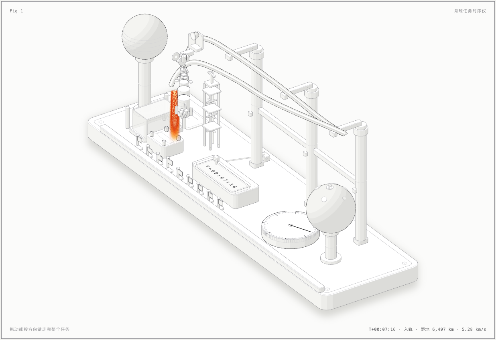

# 月球任务时序仪 · Lunar Mission Sequencer

一台可交互的等距仪器。它的**导轨被弯成了阿波罗 11 号的任务剖面**：滑架吊着一枚土星五号模型，从左侧发射台升空，沿导轨飞向右侧的月球，把登月舱吊放到月面，再沿更低的返回弧折回，最后溅落在左前方的水箱里。台面上的相位表盘、任务钟、九面事件旗和尾焰，全部由同一份真实任务数据驱动。



## 一、为什么是这台机器

`anatomy` 的做法是：不要画框、箭头和标注，而是**造一台真实机器，让它的运转本身就是那个概念**。

| 概念 | 机器上的对应物 |
|---|---|
| 整条任务剖面 | 一根被弯成该形状的导轨（凸轮） |
| 任务进度 | 滑架在导轨上的位置 |
| 高度 | 导轨在该点的世界高度 |
| 级间分离 | 对应的箭体段从滑架上消失 |
| 登月舱下降/上升 | 滑架停在月面上方，卷扬机单独吊放 |
| 环月轨道上的指令舱 | 滑架停在原地，登月舱离开它 |
| 再入与溅落 | 导轨陡降，指令舱落进玻璃水箱，水面起环 |
| 相位 | 表盘上一格；任务钟上真实 MET |
| 九个关键事件 | 台沿上九面旗，走到一个升起一个 |

## 二、真值

所有数字来自阿波罗 11 号的真实时序，写在 `src/model.mjs` 里，是整张图唯一的真值来源：

| 事件 | MET | 导轨进度 |
|---|---|---|
| 点火升空 | T+00:00:00 | 0.00 |
| 一级分离 | T+00:02:42 | 0.055 |
| 停泊轨道 | T+00:11:49 | 0.115 |
| 地月转移注入 | T+02:44:16 | 0.20 |
| 环月轨道进入 | T+75:49:50 | 0.55 |
| 月面着陆 | T+102:45:40 | 0.70 |
| 上升与对接 | T+128:03:00 | 0.78 |
| 返回点火 | T+135:23:42 | 0.86 |
| 再入溅落 | T+195:18:35 | 1.00 |

全程 8 天 3 小时 18 分 35 秒，往返 384,400 km。土星五号高 110.6 m、起飞质量 2,970 t，地月转移注入 Δv 3.05 km/s，再入速度约 11 km/s。

导轨的高度不是画出来的，是**从悬挂几何反推**的：发射台上全箭 62 单位长、吊钩 18 单位，所以导轨在发射台处必须在 z = 90；月面着陆时登月舱底部要落在月面 z = 81，吊放行程 16，所以导轨在着陆点必须在 z = 139。剖面因此自洽：动一个数，整条导轨跟着动。

## 三、跑起来

```sh
npm run build          # 生成 dist/index.html 与 dist/index-light.html
npm run audit          # 跑几何审计（间隙、支撑、折叠、抖动、深度次序）
npm run lines          # 跑线端检查（每条线都必须落在东西上）
npm run gif            # 录 1280×800 循环 GIF 到 out/lunar-mission.gif
npm run serve          # 本地起一个静态服务器 http://127.0.0.1:4173/
```

直接打开 `dist/index-light.html` 也可以，页面是自包含的，没有任何运行时依赖。

> **本机无头浏览器**：这台机器的文件沙箱不允许 Chrome 初始化它自己的沙箱，所以截图与录屏脚本要用仓库里的包装脚本：
> ```sh
> export CHROME_PATH="$PWD/scripts/chrome-headless.sh"
> ```
> 包装脚本只是给 Chrome 加上 `--no-sandbox --disable-crashpad`，仅用于离线截图。

## 四、交互与操作入口

台面下方是一排操作入口，键盘能做的这里都能点：

| 入口 | 作用 |
|---|---|
| **播放 / 暂停** | 巡游的启停；暂停后停在当前姿态 |
| **进度滑杆** | 直接扫过整条任务时间线，右侧同步显示百分比 |
| **跳事件** | 九个真实事件的下拉，选中即跳到那一刻 |
| **速度** | 巡游速度 1× / 2× / 4× |
| **主题** | 亮色 ⇄ 暗色即时切换（两套调色板都在同一份 CSS 里，WebGL 那层跟着换着色分支，不是换页面） |
| **回到发射** | 一键复位到 T+0 |

图上还有：

- **拖动**：横向拖动整个台面，就是扫过整条任务时间线
- **方向键**：按事件步进（Shift 一次跨三个事件），`Home` 回发射，`End` 跳溅落
- **空格**：播放/暂停巡游；无人操作 3.6 秒后自动回到巡游
- 离开视口停、`prefers-reduced-motion` 下全部静止但仍可交互
- 屏幕阅读器：`role="slider"`，`aria-valuetext` 写当前相位名与 MET（只在焦点变化时更新，不逐帧播报）

## 五、级间分离

分离不是"到点消失"，而是**看得见地离开**：

| 事件 | MET | 分离方向 |
|---|---|---|
| 一级分离 | T+00:02:42 | 向后下方 |
| 逃逸塔分离 | T+00:03:17 | 向前上方（拉走，不是掉落） |
| 二级分离 | T+00:09:31 | 向后下方 |
| 三级分离 | T+02:50:56 | 向后下方 |
| 服务舱分离 | T+194:49 | 向侧下方，溅落的只有指令舱 |

脱离的那一级沿分离方向推离 54 个世界单位、绕**自身中心**轻微翻转、同时淡出，0.5 秒走完。这里有一个必须讲清楚的细节：分离进度是按 `p` 定义的（时间轴上一段 0.028 的窗口），但**画出来的进度用时间追上去、且只进不退**——否则把滑杆拖到窗口中间松手，那一级会永远定格在半分离状态。倒带时则立刻恢复成完整的箭。

## 六、零件

约 490 个实体、64 个绘制项，分五组：

- **底座**：台面、四只脚、角螺钉、内嵌槽线、前梁与标尺（刻度长在梁的边上）、铭牌（三行规则线）、接线座
- **导轨**：整根弯成剖面的圆轨（`kit/tube.mjs` 分块绘制，按球链录形状）、三根立柱、托座、横拉杆、斜撑
- **滑架**：上下两只球头（球到导轨轴线的距离与方向无关，所以滑架不必随切向俯仰）、插座、两片跨在导轨两侧的侧板、横梁、悬臂、吊钩、卷筒与手轮
- **箭体**：逃逸塔、指令舱、服务舱、登月舱（八棱柱下降级 + 四条腿 + 上升级）、三级、二级、一级（四片尾翼 + 五台 F-1），每段带 `data-stage`，分离后隐藏
- **仪表**：地球与月球球体（月面有环形山与着陆点小旗）、相位表盘（48 格刻度 + 8 格相位）、任务钟、九面事件旗、玻璃水箱、发射台与塔架、电缆

## 七、两层渲染

后层 SVG 画会被火焰盖住的东西，中间一层 WebGL 画尾焰与溅落水花，前层 SVG 画盖住火焰的东西（滑架、箭体、旗帜、前梁、水箱近侧玻璃）。

着色器在**世界空间**里工作，用的是与 SVG 完全相同的相机（`kit/gl.mjs` 的 `GLSL_ISO`）：尾焰从喷口的真实世界坐标向下积分，长度按当前发动机的喷口高度截断（发射台上不会穿过台面）；溅落环画在水面平面上，用与水箱同数字的半径掩码，不会跑出箱壁。亮色主题用的是"纸上的墨"配方：先设计纸应该显示的颜色，再反解 premultiplied 墨，饱和的体 + 近白核 + 彩色边 + alpha 地板。

## 八、验证状态

`node build.mjs --audit` 的最后一行是 **`audit passed`**：十四项检查全部归零。

| 检查 | 结果 |
|---|---|
| `node scripts/lines.mjs`（两个主题） | **line ends: 0** ✅ 266 个线端全部落在描边、点或轮廓上 |
| 间隙、间距、终端、松散端、屏幕折叠、支撑图、深度次序、飞行中穿插、自交、抖动、鞍座、替身形状、拥挤 | **全部 0** ✅ |
| 豁免名单（`allow`） | 2 对，均已逐对看过 4× 特写：滑架的两片侧板跨在导轨两侧（一对"包住"关系，没有任何单一深度键能同时排对）；电缆端面与接线座平面共面（端子检查要求端面落在座上，交线附近必然互为前后） |

审计规模：1 条管路、497 个实体、59 个绘制项、138 对屏幕重叠、136 条次序规则、3.3 s。

修审计的过程本身就是查错的过程，其中三处是**真实的建模错误**，都是靠 4× 特写和审计数字翻出来的：

1. **车削剖面的坐标原点算重了一次**——`lathe` 的 s 是从 `frame.o` 沿轴线量的，而逃逸塔、服务舱发动机、一级五台发动机的剖面用的是绝对高度、坐标原点却放在部件底部，于是整件被抬高了 2 倍底部高度：服务舱发动机飘在地球上方，一级发动机埋进箭体里。
2. **一级裙部画成了实心圆柱**——五台 F-1 全埋在实心体里，只露出几片碎面；改成薄壳环 + 开口发动机舱 + 底封头之后，发动机舱才读得出来。尾翼也从"悬空的方块"改成贴在裙外壁的板。
3. **托座与导轨的球链穿插**——录形状时导轨是一串相切的球，托座只要落进球链的包络里就会互相穿插；托座因此下移 1.0，与导轨保持可见的托举间隙。

## 九、目录

```
build.mjs              构建：两遍拟合相机 → 建场景 → 审计 → 分层输出
src/model.mjs          真值：事件表、相位表、物理量、导轨样条
src/art.mjs            几何：底座、导轨、滑架、箭体、球体、仪表
src/live.mjs           运行时：巡游、交互、深度重排、WebGL 尾焰与溅落
kit/                   anatomy 工具包（相机、实体、车削、管路、审计、WebGL）
scripts/               截图、驱动、线端检查、GIF 录制、无头 Chrome 包装
dist/                  构建产物（自包含 HTML，可直接发布）
out/lunar-mission.gif  录制好的 GIF
shots/                 复核用截图
```

## 十、录制结果

```sh
node scripts/gif.mjs dist/index-light.html --select .lms-stage \
  --width 1280 --height 800 --frames 130 --fps 12 --hold 10 --out out/lunar-mission.gif
```

`out/lunar-mission.gif` · 1280×800 · 140 帧 · 12 fps · 11.67 s · 1.47 MB · 循环。

录制脚本用 CDP 驱动无头 Chrome，逐帧调用 `window.__lunar.set(p, { settle: true })` 同步绘制目标帧，再用 ffmpeg 两遍调色板（`palettegen=stats_mode=diff` + `paletteuse=dither=bayer`）合成，画质优先。

## 十一、许可

MIT © zexuan.peng
